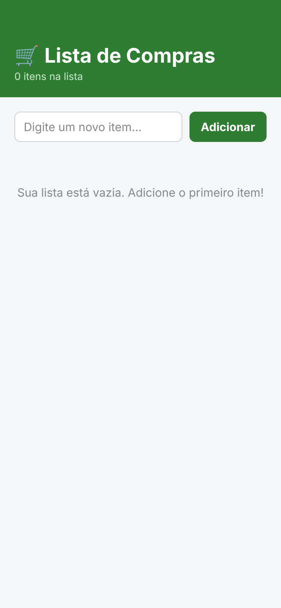
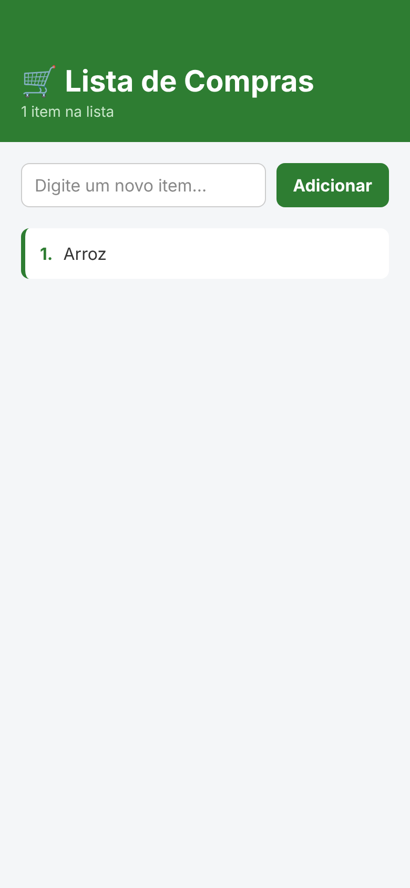
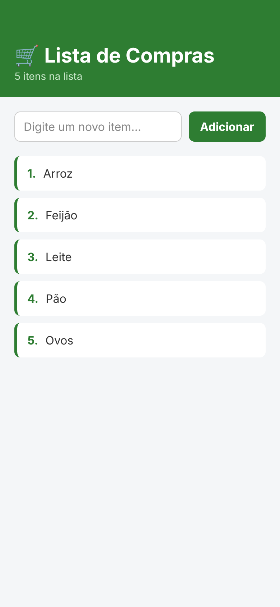

# Lista de Compras (CheckPoint 2) - Cross-platform application development
Daniel Silva de Castro - 2CCPS 

App React Native de lista de compras simples.

- Título do app
- `TextInput` para digitar um novo item
- Botão **Adicionar** que insere o item na lista com `useState`, criando um array novo com o spread operator (`[...itens, novoItem]`), sem `.push()`
- Lista exibida com `FlatList`

## Prints

| Lista vazia | 1 item | 5 itens |
|---|---|---|
|  |  |  |
